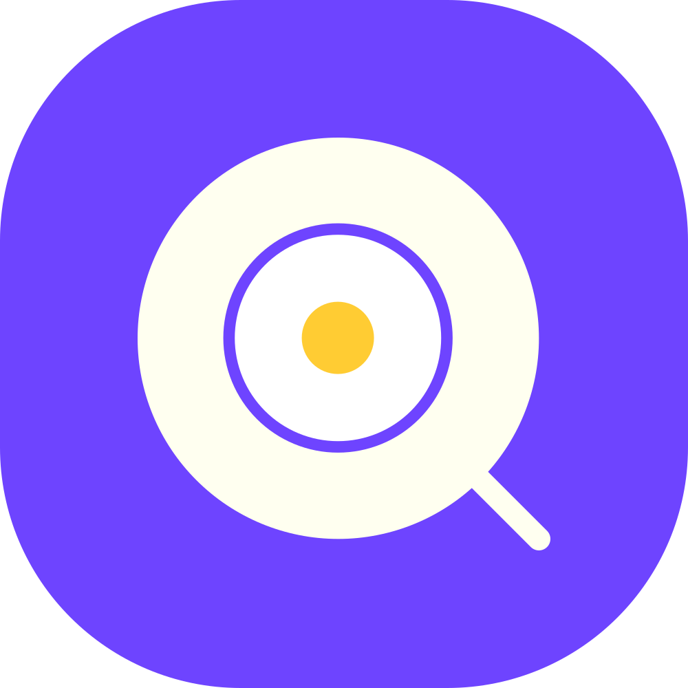
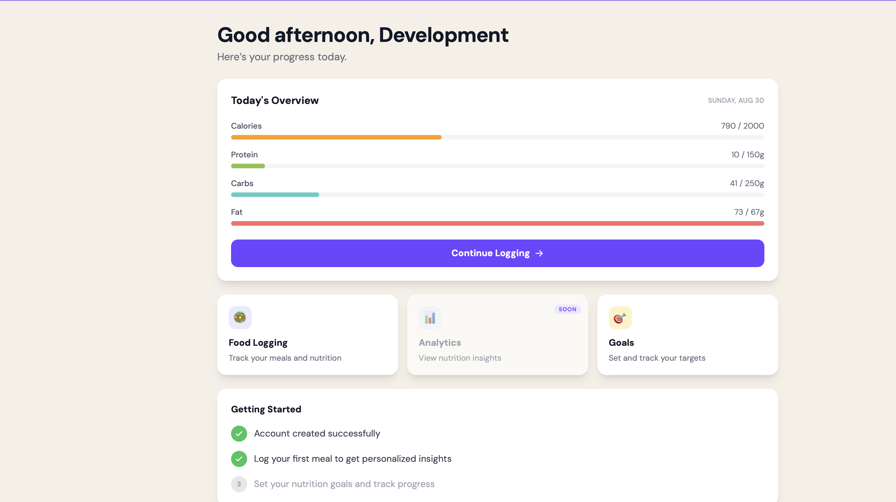
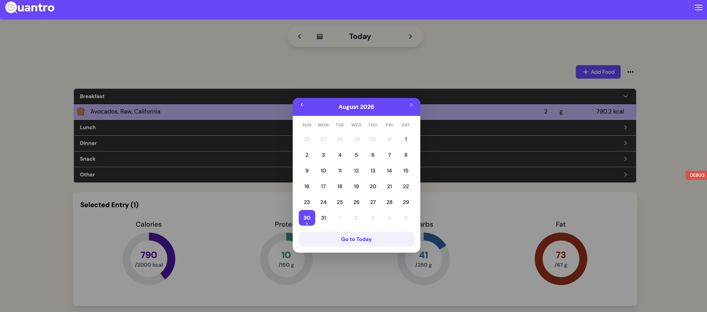
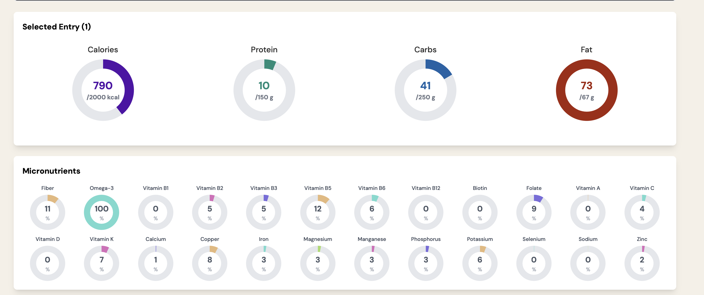

# Quantro - Calorie Counter

## Status: No longer actively developed
---
## Overview 

Quantro is a full-stack nutrition tracking web application focused on nutrient quality, calories and macronutrients.

I began this project during my final quarter of college to experiment with software development and product ownership. The project gave me hands-on experience across frontend development, backend APIs, databases, authentication, third-party integrations, cloud infrastructure, product design, and AI-assisted software development.

---

## Screenshots

### Dashboard

### Calendar

### Nutrition Tracking

## What It Does

Quantro was designed to make detailed nutrition tracking more intuitive and interactive.

- Log meals by type: breakfast, lunch, dinner, and snack
- Search foods through USDA FoodData Central and FatSecret
- Track macronutrients and 17 micronutrients against daily goals
- Review nutrition progress through dashboards, charts, and summaries
- Support invite-only beta access and admin-managed invitations
- Authenticate users through email and OAuth

The application was developed and tested as a closed beta.

---

## Tech Stack

- Next.js 16 (App Router)
- TypeScript
- React 19
- Tailwind CSS
- Zustand
- Prisma 7
- NextAuth.js v5
- USDA FoodData Central + FatSecret APIs
- Resend 
- Upstash Redis
- Sentry + Vercel Analytics
- Jest + React Testing Library + Playwright

---

## Architecture

Quantro uses a monolithic Next.js architecture deployed serverlessly on Vercel. The application combines frontend UI, API routes, authentication, database access, and third-party integrations in a single repository.

- Key architectural decisions included:
- Unified food-search abstraction across multiple providers
- Centralized validation and environment configuration
- Separation of server-side business logic from API layers
- Authentication and route protection across Edge and Node.js runtimes
- Serverless-compatible rate limiting

---

## Engineering Highlights

- Built invite-only beta access with allowlists and admin-managed invitations
- Unified food search across two external nutrition APIs
- Implemented authentication across Edge and Node.js runtimes
- Added serverless-compatible rate limiting with a local fallback
- Built inline editing, drag-and-drop interactions, and optimistic UI updates
- Integrated and normalized nutrition data from multiple third-party sources
- Added automated testing across unit, component, and end-to-end layers

---

## Project Timeline

- **Spring 2025** — Project conceived months during my final quarter of college
- **2025** — Product design, development, and technical experimentation
- **Summer 2025** — Business formation and brand development
- **2025–2026** — Closed-beta development and testing
- **2026** — Development concluded and repository prepared for public release

---

## Disclaimer

Quantro was developed as a software project and is not intended to provide medical or nutritional advice. Nutrition information is sourced from third-party databases and may contain inaccuracies.

---

## License

All rights reserved. This source code is publicly available for viewing and reference only. No permission is granted to copy, modify, distribute, or use the code without prior written permission.
